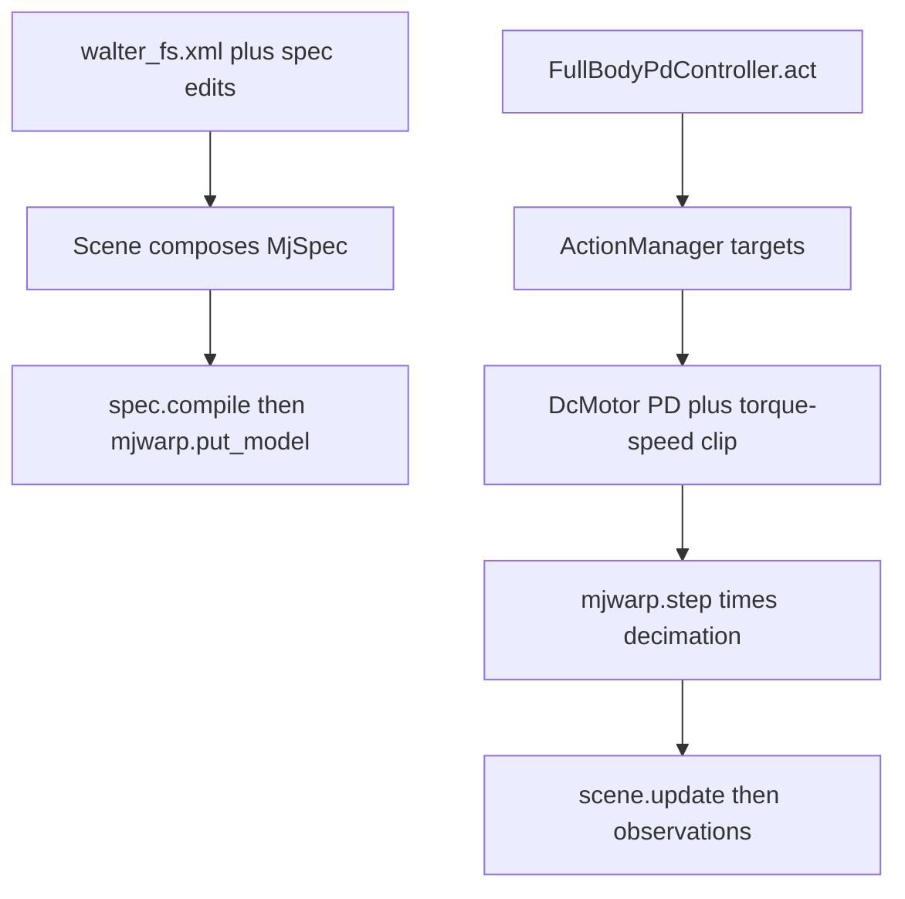

# Simulation and control

This note is for a new lab member who wants to see how MuJoCo and mjlab become a robot controller. Install, the play CLI, and the gain table live in [README.md](README.md). This file follows the path from an MJCF file to a joint torque.

Three layers sit on top of each other:

- **MuJoCo** stores the robot. An `MjSpec` is the editable scene (bodies, joints, geoms, actuators). `spec.compile()` turns it into an `MjModel`. Each step reads and writes an `MjData`, including `data.ctrl`, the actuator input array the solver turns into forces.
- **mjlab** (`mjlab/src/mjlab/`) batches many copies of that model with [MuJoCo Warp](https://github.com/google-deepmind/mujoco_warp) and wraps them as a manager-based environment. Warp is the GPU (or CPU) implementation of MuJoCo’s `mj_step`.
- **`walter_rl`** loads the full-scale WaLTER MJCF, attaches CubeMars DC motors, and fills the action vector with [`FullBodyPdController`](src/walter_rl/control/full_body_pd/controller.py).



The command that runs this loop is:

```bash
uv run python scripts/play_pd.py --task flat
```

[`scripts/play_pd.py`](scripts/play_pd.py) builds the environment, wraps the controller as a policy, and hands both to a viewer:

```python
env = make_pd_env(
  task,
  play=True,
  num_envs=args.num_envs,
  payload=args.payload,
)
policy = FullBodyPdPolicy(env)
viewer = ViserPlayViewer if args.viewer == "viser" else NativeMujocoViewer
try:
  viewer(env, policy).run()
finally:
  env.close()
```

`--viewer viser` opens a browser UI. `--viewer native` opens MuJoCo’s passive viewer.

## Building the model

mjlab assembles the robot scene as an `MjSpec` in Python, then compiles it once when the environment is created.

[`Scene`](mjlab/src/mjlab/scene/scene.py) starts from [`scene.xml`](mjlab/src/mjlab/scene/scene.xml), which is only visualization defaults (headlight, statistic size). Terrain, robots, and sensors are attached after that:

```python
self._spec = mujoco.MjSpec.from_file(str(_SCENE_XML))
if self._cfg.extent is not None:
  self._spec.stat.extent = self._cfg.extent
self._add_terrain()
self._add_entities()
self._add_sensors()
if self._cfg.spec_fn is not None:
  self._cfg.spec_fn(self._spec)
```

Each entry in `scene.entities` is an `EntityCfg`. The scene builds it (`ent = ent_cfg.build()`), then welds its spec into the world under a name prefix. WaLTER is the entity named `robot`, so its bodies and joints show up as `robot/torso`, `robot/torso_left_thigh_joint`, and so on:

```python
frame = self._spec.worldbody.add_frame()
self._spec.attach(ent.spec, prefix=f"{ent_name}/", frame=frame)
```

WaLTER’s config is assigned in [`_configure_scene`](src/walter_rl/tasks/velocity/config/walter_fs/env_cfgs.py):

```python
cfg.scene.entities = {"robot": get_walter_fs_robot_cfg()}
```

The robot description starts as the checked-in MJCF [`walter_fs.xml`](src/walter_rl/assets/walter_fs/walter_fs.xml): a free torso, four hip hinges, four continuous knee hinges, eight driven wheels, and a waist joint named `head_joint`. [`get_spec()`](src/walter_rl/assets/walter_fs/walter_constants.py) loads that file and edits the spec before mjlab compiles it. Hips are limited, wheel contact parameters are replaced, the generator’s `<actuator>` elements are deleted, and an IMU site is added:

```python
def get_spec() -> mujoco.MjSpec:
  """Load the FS MJCF and prepare it for mjlab actuation."""
  spec = mujoco.MjSpec.from_file(str(WALTER_FS_XML))
  _name_body_geoms(spec)
  _limit_hip_joints(spec)
  _stabilize_wheel_contacts(spec)
  _add_wheel_visuals(spec)
  _add_contact_bumps(spec)
  _strip_generator_actuators(spec)
  _add_imu(spec)
  return spec
```

Deleting the generator motors is what lets mjlab attach its own. `_strip_generator_actuators` walks `spec.actuators` and calls `spec.delete` on each one.

Compilation happens inside [`Simulation`](mjlab/src/mjlab/sim/sim.py). The spec becomes an `MjModel`, `MujocoCfg.apply` writes the integrator, solver, and timestep onto that model, and Warp uploads it:

```python
elif spec is not None:
  compiled = spec.compile()
  cfg.mujoco.apply(compiled)
  self._init_with_model(compiled)
```

```python
def _init_with_model(self, model: mujoco.MjModel) -> None:
  """Standard path: build warp model from compiled MjModel."""
  self._mj_model = model
  self._mj_data = mujoco.MjData(model)
  mujoco.mj_forward(self._mj_model, self._mj_data)

  with wp.ScopedDevice(self.wp_device):
    self._wp_model = mjwarp.put_model(self._mj_model)
    self.cfg.apply_wp_opt(self._wp_model.opt)
    self._finish_init()
```

`put_model` copies the compiled model into Warp. `put_data`, called while finishing init, allocates one `MjData` per parallel environment (`nworld = num_envs`). The host `MjModel` stays around for viewers and XML export. The stepping itself is Warp:

```python
def step(self) -> None:
  with wp.ScopedDevice(self.wp_device):
    with self.nan_guard.watch(self.data):
      if self.use_cuda_graph and self.step_graph is not None:
        wp.capture_launch(self.step_graph)
      else:
        mjwarp.step(self.wp_model, self.wp_data)
```

`mjwarp.step` is MuJoCo’s `mj_step` on every world at once: read `ctrl`, solve contacts, integrate positions and velocities. On CUDA the same call is captured into a graph and replayed.

`MujocoCfg.apply` is where solver choices land on the compiled model. The fields a new scene usually changes are `timestep`, `integrator` (`implicitfast` by default), `solver` (`newton`), `cone`, and `impratio`:

```python
model.opt.jacobian = _JACOBIAN_MAP[self.jacobian]
model.opt.cone = _CONE_MAP[self.cone]
model.opt.integrator = _INTEGRATOR_MAP[self.integrator]
model.opt.solver = _SOLVER_MAP[self.solver]
model.opt.timestep = self.timestep
```

## Time and one environment step

mjlab splits the clock in two. The physics timestep is how often Warp integrates. **Decimation** is how many of those physics steps run before the policy is asked for a new action. The environment period is their product:

```python
@property
def step_dt(self) -> float:
  """Environment step size (physics_dt * decimation)."""
  return self.cfg.sim.mujoco.timestep * self.cfg.decimation
```

The velocity task that WaLTER starts from sets both numbers in [`velocity_env_cfg.py`](mjlab/src/mjlab/tasks/velocity/velocity_env_cfg.py):

```python
sim=SimulationCfg(
  nconmax=35,
  njmax=1500,
  mujoco=MujocoCfg(
    timestep=0.005,
    iterations=10,
    ls_iterations=20,
  ),
),
decimation=4,
```

Physics runs every 5 ms (200 Hz). The policy runs every `0.005 * 4 = 0.02` s (50 Hz). The action tensor stays constant across those four substeps. A relative knee term still adds its delta on every substep, because `apply_action` runs inside the loop.

Wheel rolling contacts need a tighter contact solve than that factory default. [`_configure_sim`](src/walter_rl/tasks/velocity/config/walter_fs/env_cfgs.py) switches to an elliptic friction cone, raises the friction-to-normal impedance ratio, and reserves more contact slots:

```python
def _configure_sim(cfg: ManagerBasedRlEnvCfg) -> None:
  """Give the wheel contacts a bit more solver budget than the factory default."""
  cfg.sim.mujoco.ccd_iterations = 100
  cfg.sim.mujoco.impratio = 10
  cfg.sim.mujoco.cone = "elliptic"
  cfg.sim.contact_sensor_maxmatch = 64
  cfg.sim.nconmax = 256
```

`ManagerBasedRlEnv` is the object you `reset()` and `step()`. On construction it loads a set of managers, each of which owns one dictionary on the config: events, commands, actions, observations, terminations, rewards, and an optional curriculum. WaLTER fills those dictionaries by taking `make_velocity_env_cfg()` and editing it in `walter_fs_flat_env_cfg`, `walter_fs_rough_env_cfg`, `walter_fs_rough_test_env_cfg`, and `walter_fs_stairs_env_cfg`.

One `env.step(action)` does this. The action is processed once, then applied on every physics substep:

```python
self.action_manager.process_action(action.to(self.device))

for _ in range(self.cfg.decimation):
  self._sim_step_counter += 1
  self.action_manager.apply_action()
  self.scene.write_data_to_sim()
  self.sim.step()
  self.scene.update(dt=self.physics_dt)
```

`process_action` scales, offsets, and clips the flat action vector. `apply_action` writes joint targets. `write_data_to_sim` turns those targets into `data.ctrl`. `sim.step` integrates. `scene.update` refreshes joint state and sensors at the physics `dt`.

After the four substeps, still inside the same `step()` call, the env checks terminations, computes the reward, fires step and interval events, resets finished environments, runs one `sim.forward()` so kinematics match the latest `qpos`, updates the command (the `twist` the controller tracks), calls `sim.sense()` for raycasts and contacts, and computes observations. Rewards and terminations see derived quantities from the previous substep; `forward()` refreshes them before the next observation.

## From an action number to a joint torque

A policy, or the PD controller, returns a flat tensor with one row per environment. The action manager splits that row into terms. For the velocity task those terms are hips, knees, and wheels:

```python
cfg.actions = {
  "hip_pos": JointPositionActionCfg(
    entity_name="robot",
    actuator_names=(r".*_thigh_joint",),
    scale=HIP_ACTION_SCALE,
    use_default_offset=True,
    clip={r".*_thigh_joint": (-HIP_ANGLE_LIMIT, HIP_ANGLE_LIMIT)},
  ),
  "knee_pos": RelativeJointPositionActionCfg(
    entity_name="robot",
    actuator_names=(r".*_thigh_shin_joint",),
    scale=KNEE_ACTION_SCALE,
  ),
  "wheel_vel": JointVelocityActionCfg(
    entity_name="robot",
    actuator_names=(r".*wheel_joint",),
    scale=WHEEL_ACTION_SCALE,
    use_default_offset=False,
  ),
}
```

`HIP_ACTION_SCALE`, `KNEE_ACTION_SCALE` (`0.03` rad), and `WHEEL_ACTION_SCALE` (`30` rad/s) are defined next to the robot in [`walter_constants.py`](src/walter_rl/assets/walter_fs/walter_constants.py). Hips are an absolute position: default pose plus the scaled action, clipped to the ±70° stop. Knees on the RL task are a relative step added to the current angle on every physics substep. Wheels are a velocity target.

Each term writes that target onto the entity. A position term does:

```python
def apply_actions(self) -> None:
  encoder_bias = self._entity.data.encoder_bias[:, self._target_ids]
  target = self._processed_actions - encoder_bias
  self._entity.set_joint_position_target(target, joint_ids=self._target_ids)
```

A velocity term calls `set_joint_velocity_target` with the same processed action.

Those targets are still setpoints. Torque is computed in Python by the actuator, then stored in `data.ctrl` for Warp. The motors that do this are declared in `_DC_MOTORS`: one `DcMotorActuator` group per joint class, each bound to a CubeMars model, an external gear, and a PD pair.

```python
_DC_MOTORS = (
  (".*_thigh_joint", "ak70_10_kv100", HIP_GEAR_RATIO, HIP_STIFFNESS, HIP_DAMPING),
  (
    ".*_thigh_shin_joint",
    "ak80_64_kv80",
    KNEE_GEAR_RATIO,
    KNEE_STIFFNESS,
    KNEE_DAMPING,
  ),
  (".*wheel_joint", "ak10_9_v2_kv60", WHEEL_GEAR_RATIO, 0.0, WHEEL_VELOCITY_GAIN),
)
```

Hips use an AK70-10, knees an AK80-64, wheels an AK10-9. The gear ratios (`33`, `1.6`, and `1.0`) scale the datasheet torque–speed curve out to the joint. Wheel stiffness is `0` and the damping entry is `WHEEL_VELOCITY_GAIN`, so the same PD law is a velocity servo: torque is `gain * (velocity_target - velocity)`. Datasheets and the curve fit are in [`motor_models/README.md`](src/walter_rl/assets/motor_models/README.md).

The PD sum itself is shared by the ideal actuator and the DC motor:

```python
def pd_torque(
  stiffness: torch.Tensor, damping: torch.Tensor, cmd: ActuatorCmd
) -> torch.Tensor:
  """Ideal PD control torque, unclamped.

  kp * (pos_target - pos) + kd * (vel_target - vel) + effort_target. Shared by
  the ideal PD and DC motor control laws so the PD sum lives in one place.
  """
  torque = stiffness * (cmd.position_target - cmd.pos)
  torque += damping * (cmd.velocity_target - cmd.vel)
  torque += cmd.effort_target
  return torque
```

`DcMotorActuator` runs that law, then clips the result to the motor’s linear torque–speed curve and to the effort limit. Stall torque is available at zero speed; torque falls to zero at the no-load speed:

```python
@staticmethod
def control_law(params: dict[str, torch.Tensor], cmd: ActuatorCmd) -> torch.Tensor:
  torque = pd_torque(params["stiffness"], params["damping"], cmd)
  return dc_motor_clip(
    torque,
    params["saturation_effort"],
    params["velocity_limit_motor"],
    params["force_limit"],
    cmd.vel,
  )
```

`Entity.write_data_to_sim` is the call in the decimation loop that runs every actuator and writes `data.ctrl`:

```python
def write_data_to_sim(self) -> None:
  """Convert actuator targets into low-level controls and write them to the sim.

  Called before each ``sim.step()`` within the decimation loop. Builtin actuators are
  applied in a single batched operation; custom actuators are applied individually.
  """
  self._apply_actuator_controls()
```

```python
def write_ctrl(
  self,
  ctrl: torch.Tensor,
  ctrl_ids: torch.Tensor | slice | None = None,
  env_ids: torch.Tensor | slice | None = None,
) -> None:
  if not self.is_actuated:
    raise ValueError("Cannot write control for non-actuated entity.")

  env_ids = self._resolve_env_ids(env_ids)
  local_ctrl_ids = ctrl_ids if ctrl_ids is not None else slice(None)
  global_ctrl_ids = self.indexing.ctrl_ids[local_ctrl_ids]
  self.data.ctrl[env_ids, global_ctrl_ids] = ctrl
```

The `<motor>` elements mjlab added to the spec have a fixed gain, so the number in `ctrl` is the joint torque MuJoCo applies on the next `mjwarp.step`. The transmission and the force limit live on the spec; the PD law and the torque–speed clip live in PyTorch.

## How WaLTER is controlled

Interactive play uses the same scene factories as the velocity task, then adds a waist servo and changes the knee action from a relative step to an absolute angle. [`make_pd_env`](src/walter_rl/control/full_body_pd/env.py) is that builder:

```python
def make_pd_env(
  task: TaskName = "flat",
  *,
  play: bool = False,
  num_envs: int = 1,
  device: str | None = None,
  gains: FullBodyPdGains | None = None,
  easy_rough: bool = False,
  lock_speed: float | None = None,
  lock_heading: float = 0.0,
  episode_length_s: float | None = None,
  payload: str | None = None,
) -> ManagerBasedRlEnv:
  """Build a Walter env whose action vector includes the waist hold."""
  chosen = "rough" if easy_rough else task
  cfg = _CFG_FOR_TASK[chosen](play=play)
  _add_waist_lock(cfg, gains if gains is not None else default_gains())
  if payload is not None:
    _weld_payload(cfg, payload)
  cfg.scene.num_envs = num_envs
  if episode_length_s is not None:
    cfg.episode_length_s = episode_length_s
  if easy_rough:
    _apply_easy_rough(cfg)
  if not play:
    _quiet(cfg)
  if lock_speed is not None:
    _lock_command(cfg, lock_speed, lock_heading)
  _drop_rewards_without_sensors(cfg)
  if play:
    _drop_play_overhead(cfg)
  return ManagerBasedRlEnv(cfg, device=device or _default_device())
```

`_add_waist_lock` rebuilds the robot with the play-controller hip and knee gains, appends a position actuator on `head_joint`, and adds a matching action column. The RL robot config is left unchanged; this actuator exists only on the PD environment:

```python
robot.articulation.actuators = (
  *robot.articulation.actuators,
  BuiltinPositionActuatorCfg(
    target_names_expr=("head_joint",),
    stiffness=gains.waist.kp,
    damping=gains.waist.kd,
    effort_limit=gains.waist.effort_limit,
  ),
)
cfg.scene.entities["robot"] = robot
_use_absolute_knee_action(cfg)
cfg.actions["waist"] = JointPositionActionCfg(
  entity_name="robot",
  actuator_names=("head_joint",),
  scale=1.0,
  use_default_offset=True,
)
```

[`FullBodyPdPolicy`](src/walter_rl/control/full_body_pd/policy.py) is the callable the viewer steps. It ignores the observation tensor and reads the robot state plus the `twist` command (the Viser joystick writes that command):

```python
def __call__(self, obs: torch.Tensor) -> torch.Tensor:
  """Return the PD action. ``obs`` is unused."""
  del obs
  return self._controller.act()
```

`act` writes one flat row in action-manager order: hip positions from the pitch loop, knee positions from the roll loop, a tumble override when forward speed lags the command, wheel velocities from speed tracking plus skid steer, and a waist target of zero:

```python
def act(self) -> torch.Tensor:
  """Return one action row per environment."""
  self._sync_knee_servo()
  self._sync_torque_cap()
  self._sync_speed_cap()
  self._forget_finished_episodes()
  actions = torch.zeros(
    self._env.num_envs, self._action_dim, device=self._env.device
  )
  robot = self._env.scene["robot"]
  self._apply_pitch(actions, robot)
  self._apply_roll(actions, robot)
  self._apply_tumble(actions, robot)
  self._apply_wheels(actions, robot)
  actions[:, self._waist_column] = 0.0
  return actions
```

Pitch splays the downhill hips. Roll extends the inner legs. Tumble integrates missed forward distance and, past a threshold, spins the knees about +Y. Wheels track `lin_vel_x` and yaw from `ang_vel_z`. The numeric gains are the dataclasses in [`gains.py`](src/walter_rl/control/full_body_pd/gains.py). Hip, knee, and waist actuator gains are copied onto the actuators when the environment is built, so a change there needs a restart. Tank Mode knee gains are the exception: `_sync_knee_servo` writes them when the checkbox changes. The gain table and what each loop does are in the README.

The viewer closes the loop at `step_dt` (20 ms), once per policy step:

```python
with torch.no_grad():
  obs = self.env.get_observations()
  actions = self.policy(obs)
  self.env.step(actions)
```

## Terrain

The velocity task’s terrain is another entity, built before compile. For `terrain_type="generator"`, [`TerrainEntity`](mjlab/src/mjlab/terrains/terrain_entity.py) creates an empty spec and asks [`TerrainGenerator.compile`](mjlab/src/mjlab/terrains/terrain_generator.py) to add a `terrain` body, a grid of sub-terrains, a border, and lights:

```python
def compile(self, spec: mujoco.MjSpec) -> None:
  body = spec.worldbody.add_body(name="terrain")

  if self.cfg.curriculum:
    self._generate_curriculum_terrains(spec)
  else:
    self._generate_random_terrains(spec)

  self._add_terrain_border(spec)
  self._add_grid_lights(spec)
```

Rows are difficulty, columns are terrain type. WaLTER keeps that generator and only changes slopes, stair heights, and which rows the curriculum uses. `flat` replaces the grid with a plane. `rough`, `rough-test`, and `stairs` are the three grids. The scene table is in the README.

## Where to change things

| You want to… | Edit |
| --- | --- |
| Change geometry, masses, or collision | [`walter_fs.xml`](src/walter_rl/assets/walter_fs/walter_fs.xml) and `get_spec()` in [`walter_constants.py`](src/walter_rl/assets/walter_fs/walter_constants.py) |
| Change the training motors or their PD gains | `_DC_MOTORS` in the same file |
| Change how the play controller balances and drives | [`gains.py`](src/walter_rl/control/full_body_pd/gains.py) and [`controller.py`](src/walter_rl/control/full_body_pd/controller.py) |
| Add a scene, observation, or reward | [`env_cfgs.py`](src/walter_rl/tasks/velocity/config/walter_fs/env_cfgs.py), starting from `make_velocity_env_cfg()` |
| Change the solver, timestep, or batch size | `SimulationCfg` / `MujocoCfg` on the env config, and `cfg.scene.num_envs` |

To step the controller without a viewer:

```python
from walter_rl.control.full_body_pd.env import make_pd_env
from walter_rl.control.full_body_pd.policy import FullBodyPdPolicy

env = make_pd_env("rough", play=True, num_envs=1)
policy = FullBodyPdPolicy(env)
action = policy(env.reset()[0])
env.close()
```

`policy` ignores the observation tensor. It reads the robot state and the `twist` command.
